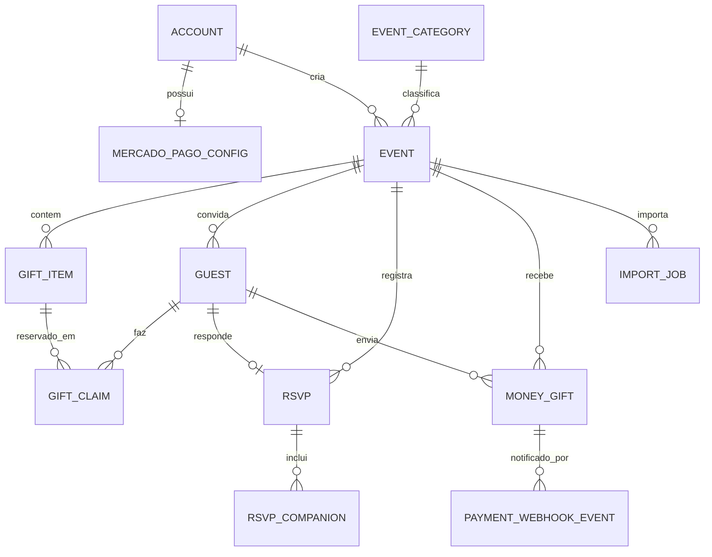
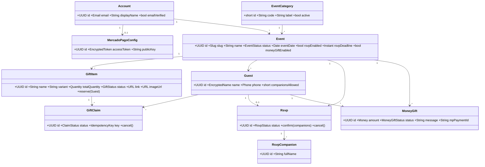

# SDD — Plataforma de Lista de Presentes (Casamento / Chá de Panela / Chá de Casa Nova)

**Documento de Design de Software (Software Design Document)**
**Versão:** 1.0 (decisões fechadas)
**Autor:** Nathan
**Data:** 21/06/2026

---

## 1. Visão geral

Plataforma **SaaS multi-tenant** onde casais se cadastram, criam um ou mais **eventos** (casamento, chá de panela, chá de casa nova, etc.) e disponibilizam uma **lista de presentes** pública. Convidados acessam por um link, se identificam apenas pelo **telefone** (sem cadastro), escolhem presentes, podem **dar dinheiro** ao casal (via Mercado Pago) e **confirmam/cancelam presença**.

Pilares do projeto:

- Segurança como requisito de primeira classe (PII protegida, isolamento entre tenants, OWASP Top 10, LGPD).
- **Idempotência** nas operações críticas (escolha de presente e pagamento) para nunca gerar presente duplicado nem "vender" além do estoque.
- Banco **PostgreSQL** modelado na **3ª Forma Normal**.
- Deploy no **Railway**, configuração por variáveis de ambiente.

---

## 2. Escopo

### 2.1 Dentro do escopo (MVP)

- Cadastro/login de **admin (casal)** = conta tenant.
- Criação de **eventos** por conta, cada um com sua lista, lista de convidados, RSVP e configurações.
- **Importação da lista de presentes** via CSV, com modelo (template) para download.
- **Importação da lista de convidados** via CSV/XLSX (nome completo + telefone).
- **Identificação do convidado por telefone** (sem verificação no MVP — ver §7.3).
- **Escolha de presente** idempotente, com baixa automática de estoque e ocultação quando esgota.
- **Presente em dinheiro** via Mercado Pago (valor definido pelo convidado), confirmado por **webhook**.
- **Confirmação de presença (RSVP)** com data-limite opcional; convidado pode cancelar a qualquer momento.
- **Painel do admin**: dashboard de presenças, presentes escolhidos e dinheiro recebido.
- **Configuração do Mercado Pago** pelo admin.

### 2.2 Fora do escopo (futuro)

- Verificação do convidado por **OTP (SMS/WhatsApp)** — arquitetura já preparada para plugar (Strategy, ver §7.3).
- Temas/personalização visual avançada, multi-idioma.
- App mobile nativo.
- Relatórios financeiros avançados / exportações fiscais.

---

## 3. Decisões de arquitetura e stack

| Camada | Tecnologia | Observação |
|---|---|---|
| Backend | **Java 25 + Spring Boot 4.1** | Spring Web MVC, Spring Data JPA, Spring Security, Bean Validation, Flyway (módulo `spring-boot-flyway`). Build: Gradle |
| Banco | **PostgreSQL** | no Railway (plugin) |
| Pagamentos | **Mercado Pago** (Checkout Pro + Webhooks) | SDK oficial Java |
| Parsing de arquivos | Apache POI (XLSX) + Apache Commons CSV (CSV) | importação com relatório de erros por linha |
| Migrations | **Flyway** | versionamento de schema |
| Frontend | **Next.js (React)** | decidido — SSR p/ preview no WhatsApp; você programa em React normal |
| Deploy | **Railway** | serviço backend + Postgres (+ serviço frontend); env vars / secrets |

### 3.1 Frontend — Next.js (React) [decidido]

Backend em Spring Boot; frontend em **Next.js (React) + Tailwind**, consumindo a API REST.

- **Por que Next e não React puro (SPA):** Next.js *é* React — você escreve componentes React do mesmo jeito. A diferença é o **SSR/SSG**, essencial para as páginas públicas compartilhadas por link no **WhatsApp**: o Next gera o _preview_ Open Graph (nome do casal, foto, título), enquanto um SPA puro (Vite/CRA) aparece como link "cru". Também é o ideal para prototipar com **Claude Design**.
- Migrar para SPA puro depois (se quiser) é troca pequena, pois a API é a mesma.

### 3.2 Estilo arquitetural — Clean Architecture

Organização em camadas (alinhado com os padrões que você está estudando):

- **Domain** — entidades e _value objects_ (`Telefone`/E.164, `Dinheiro`/BRL, `Quantidade`), regras de negócio puras, sem dependência de framework.
- **Application** — casos de uso (`ImportarListaPresentes`, `EscolherPresente`, `CriarPresenteDinheiro`, `ConfirmarPresenca`, `ImportarConvidados`...) e **ports** (interfaces de repositório/gateway). Usa **DTOs** de entrada/saída.
- **Infrastructure** — **adapters**: repositórios JPA, gateway do Mercado Pago, parser de arquivos, serviço de criptografia. Aplica **DIP** (a aplicação depende das interfaces, não das implementações).
- **Presentation** — controllers REST + **Presenters** que montam as respostas.
- **Strategy/OCP** — a verificação do convidado é uma estratégia plugável (`NoVerificationStrategy` hoje, `SmsOtpStrategy` no futuro) sem alterar o caso de uso.

### 3.3 Casos de uso (application layer)

| Caso de uso | Ator | Resumo |
|---|---|---|
| RegistrarConta | Admin | cria conta tenant + envia verificação de e-mail |
| AutenticarAdmin | Admin | login, emite token de sessão |
| ConfigurarMercadoPago | Admin | salva credenciais MP (criptografadas) |
| CriarEvento | Admin | cria evento (categoria, data, flags, prazo RSVP) |
| BaixarTemplatePresentes | Admin | gera CSV modelo |
| ImportarListaPresentes | Admin | importa CSV de presentes (idempotente) |
| ImportarConvidados | Admin | importa CSV/XLSX (nome, telefone, acompanhantes) |
| ConsultarDashboard | Admin | presenças, presentes escolhidos, dinheiro recebido |
| IniciarSessaoConvidado | Convidado | telefone → token escopado ao evento |
| ListarPresentes | Convidado | lista itens `AVAILABLE` do evento |
| EscolherPresente | Convidado | reserva idempotente, baixa de estoque |
| CancelarPresente | Convidado | libera a reserva |
| CriarPresenteDinheiro | Convidado | gera preference MP a partir do valor |
| ConfirmarPresenca | Convidado | RSVP dela + acompanhantes (≤ limite) |
| CancelarPresenca | Convidado | cancela RSVP a qualquer momento |
| ProcessarWebhookPagamento | Sistema | confirma pagamento (idempotente) |

**Detalhamento dos casos críticos:**

- **EscolherPresente** — *pré:* sessão de convidado válida, item `AVAILABLE`. *Regra:* lock de linha no item, sem claim prévio do mesmo convidado, `claims_ativos < total_quantity`. *pós:* `gift_claim` criado; se esgotou, item vira `SOLD_OUT`. *Idempotência:* `Idempotency-Key`.
- **ConfirmarPresenca** — *pré:* sessão válida, dentro do `rsvp_deadline`. *Regra:* `qtd_acompanhantes <= guest.companions_allowed`. *pós:* `rsvp` (CONFIRMED) + N `rsvp_companion`. Reenvio atualiza (upsert).
- **CriarPresenteDinheiro** — *pré:* `money_gift_enabled`, MP configurado. *pós:* `money_gift` (PENDING) + preference MP; retorna `init_point`.
- **ProcessarWebhookPagamento** — *pré:* assinatura válida. *Regra:* dedup por `mp_event_id` e `mp_payment_id`. *pós:* `money_gift.status` atualizado. Reprocessamento é no-op.
- **ImportarConvidados** — *Regra:* dedup por `(event_id, phone_hash)`; `acompanhantes` vazio = 0. *pós:* `import_job` com relatório por linha.

---

## 4. Modelo de dados (PostgreSQL, 3NF)

### 4.1 Diagrama (ER)



### 4.2 Tabelas

**account** (tenant = casal)

| coluna | tipo | nota |
|---|---|---|
| id | UUID PK | |
| email | citext UNIQUE | login |
| password_hash | text | Argon2id/BCrypt |
| display_name | text | |
| email_verified | bool | |
| status | enum(ACTIVE/SUSPENDED) | |
| created_at / updated_at | timestamptz | |

**mercado_pago_config** (1:1 com account)

| coluna | tipo | nota |
|---|---|---|
| id | UUID PK | |
| account_id | UUID FK UNIQUE | 1:1 |
| access_token_encrypted | bytea | **criptografado em repouso** (envelope encryption) |
| public_key | text | |
| webhook_secret_encrypted | bytea | validação de assinatura |
| updated_at | timestamptz | |

**event**

| coluna | tipo | nota |
|---|---|---|
| id | UUID PK | |
| account_id | UUID FK | |
| slug | text | único por conta; usado na URL pública |
| name | text | |
| category_id | smallint FK | → `event_category` (ver §4.2.1) |
| description | text | |
| event_date | date | |
| rsvp_enabled | bool | |
| rsvp_deadline | timestamptz NULL | **opcional** |
| money_gift_enabled | bool | |
| status | enum(DRAFT/PUBLISHED/CLOSED) | |
| created_at / updated_at | timestamptz | |

> UNIQUE (account_id, slug).

**event_category** (tabela de domínio — categorias do evento)

| coluna | tipo | nota |
|---|---|---|
| id | smallint PK | |
| code | text UNIQUE | identificador estável |
| label | text | rótulo exibido |
| active | bool | permite desativar sem apagar |

#### 4.2.1 Categorias semeadas (seed inicial)

| code | label |
|---|---|
| CASAMENTO | Casamento |
| NOIVADO | Noivado |
| CHA_PANELA | Chá de Panela |
| CHA_COZINHA | Chá de Cozinha |
| CHA_BAR | Chá Bar |
| CHA_CASA_NOVA | Chá de Casa Nova |
| CHA_LINGERIE | Chá de Lingerie |
| BODAS | Bodas |
| OUTRO | Outro |

> Como é tabela (não enum nativo), dá pra incluir/desativar categoria sem migration de schema. `OUTRO` cobre casos fora da lista. Ajuste a seed à vontade — é só dizer o que tirar/adicionar.

**gift_item**

| coluna | tipo | nota |
|---|---|---|
| id | UUID PK | |
| event_id | UUID FK | |
| name | text | |
| variant | text NULL | "cor/material/acabamento": inox, preto, cerâmica... |
| total_quantity | int | quantidade ofertada |
| product_link | text NULL | opcional |
| image_url | text NULL | opcional |
| status | enum(AVAILABLE/SOLD_OUT/HIDDEN) | |
| natural_key | text | hash p/ idempotência de import (ver §6.4) |
| created_at / updated_at | timestamptz | |

> A quantidade já reservada **não** é armazenada (seria dado derivado, violaria 3NF). É calculada a partir de `gift_claim` sob _lock_ no momento da escolha (ver §6.1). UNIQUE (event_id, natural_key).

**gift_claim** (uma reserva de 1 unidade)

| coluna | tipo | nota |
|---|---|---|
| id | UUID PK | |
| gift_item_id | UUID FK | |
| guest_id | UUID FK | |
| status | enum(CLAIMED/CANCELLED) | |
| idempotency_key | text UNIQUE | header `Idempotency-Key` |
| created_at / cancelled_at | timestamptz | |

> UNIQUE (gift_item_id, guest_id) WHERE status = 'CLAIMED' (índice parcial): impede o mesmo convidado reivindicar o mesmo item duas vezes.

**guest** (convidado — PII)

| coluna | tipo | nota |
|---|---|---|
| id | UUID PK | |
| event_id | UUID FK | |
| full_name_encrypted | bytea | **criptografado** |
| phone_encrypted | bytea | **criptografado** |
| phone_hash | bytea | HMAC-SHA256 → lookup por telefone sem expor o número |
| companions_allowed | smallint NOT NULL DEFAULT 0 | nº máx. de acompanhantes (vem da importação) |
| created_at | timestamptz | |

> UNIQUE (event_id, phone_hash). Login do convidado busca por `phone_hash`, nunca pelo telefone em claro. Ver §7.2.

**rsvp**

| coluna | tipo | nota |
|---|---|---|
| id | UUID PK | |
| event_id | UUID FK | |
| guest_id | UUID FK | |
| status | enum(CONFIRMED/DECLINED/CANCELLED) | |
| responded_at / updated_at | timestamptz | nº de acompanhantes derivado de `rsvp_companion` |

> UNIQUE (event_id, guest_id). Mudança de status sobrescreve a linha; histórico vai em `audit_log`.

**rsvp_companion** (acompanhante confirmado dentro de um RSVP)

| coluna | tipo | nota |
|---|---|---|
| id | UUID PK | |
| rsvp_id | UUID FK | |
| full_name | text | nome do acompanhante |
| created_at | timestamptz | |

> Regra: `count(rsvp_companion) <= guest.companions_allowed` — validada no caso de uso `ConfirmarPresenca` (e reforçável por trigger). Se `companions_allowed = 0`, a pessoa confirma só ela mesma.

**money_gift**

| coluna | tipo | nota |
|---|---|---|
| id | UUID PK | |
| event_id | UUID FK | |
| guest_id | UUID FK NULL | |
| amount | numeric(12,2) | |
| currency | char(3) | BRL |
| message | text NULL | recado ao casal |
| mp_preference_id | text NULL | |
| mp_payment_id | text UNIQUE NULL | **idempotência do webhook** |
| status | enum(PENDING/APPROVED/REJECTED/REFUNDED) | |
| created_at / updated_at | timestamptz | |

**payment_webhook_event** (idempotência/auditoria de webhook)

| coluna | tipo | nota |
|---|---|---|
| id | UUID PK | |
| mp_event_id | text UNIQUE | dedup de notificações repetidas |
| payload | jsonb | |
| processed_at | timestamptz | |

**import_job** (rastreamento de importações)

| coluna | tipo | nota |
|---|---|---|
| id | UUID PK | |
| event_id | UUID FK | |
| type | enum(GIFTS/GUESTS) | |
| filename | text | |
| status | enum(PROCESSING/DONE/FAILED) | |
| rows_total / rows_ok / rows_failed | int | |
| error_report | jsonb | erros por linha |
| created_at | timestamptz | |

**audit_log** (segurança)

| coluna | tipo | nota |
|---|---|---|
| id | UUID PK | |
| account_id | UUID FK NULL | |
| actor_type | enum(ADMIN/GUEST/SYSTEM) | |
| actor_id | UUID NULL | |
| action / entity / entity_id | text | |
| metadata | jsonb | |
| ip / user_agent | text | |
| created_at | timestamptz | |

### 4.3 Justificativa de 3NF

- **1FN:** sem grupos repetidos; valores atômicos (acompanhantes, claims e webhooks em tabelas próprias).
- **2FN:** todas as PKs são simples (UUID) → não há dependência parcial.
- **3FN:** nenhum atributo não-chave depende de outro atributo não-chave. Quantidade reservada não é armazenada (seria transitiva/derivada); a **categoria do evento** está numa tabela de domínio (`event_category`), não como atributo solto. Os demais `status` ficam como `enum` nativo do Postgres por simplicidade (viram tabela de domínio facilmente se quiser 3NF "purista").

### 4.4 Modelo de domínio (Clean Architecture — classes)



**Value objects:** `Email`, `Phone` (E.164), `Money` (BRL), `Quantity`, `Slug`, `IdempotencyKey`, `EncryptedToken`, `EncryptedName`.
**Enums:** `EventStatus`, `GiftStatus`, `ClaimStatus`, `RsvpStatus`, `MoneyGiftStatus`.
A regra de negócio (reservar presente, validar limite de acompanhantes, esgotar item) vive no **domínio**; persistência/MP/arquivos ficam na infraestrutura via _ports_ (DIP).

---

## 5. Papéis e permissões

| Ação | Admin (casal) | Convidado |
|---|---|---|
| Cadastrar conta / configurar MP | ✅ | ❌ |
| Criar evento, importar listas, definir prazo RSVP | ✅ | ❌ |
| Baixar template CSV | ✅ | ❌ |
| Ver dashboard (presenças, presentes, dinheiro) | ✅ | ❌ |
| Identificar-se por telefone | ❌ | ✅ |
| Escolher / cancelar presente | ❌ | ✅ |
| Dar dinheiro | ❌ | ✅ |
| Confirmar / cancelar presença | ❌ | ✅ |

Todo acesso de admin é **escopado por `account_id`**; todo acesso de convidado é escopado por `event_id` + sessão do convidado.

---

## 6. Fluxos principais

### 6.1 Escolher presente (idempotente, sem oversell)

1. Convidado envia `POST /public/events/{slug}/gifts/{giftId}/claim` com header `Idempotency-Key: <uuid>`.
2. Backend abre transação:
   - `SELECT ... FOR UPDATE` na linha do `gift_item` (lock de linha).
   - Conta claims ativos do item.
   - Se já existe claim para (item, convidado) → retorna o **mesmo** resultado (idempotente, sem duplicar).
   - Se `claims_ativos >= total_quantity` → 409 "esgotado".
   - Senão: insere `gift_claim`. Se `claims_ativos + 1 == total_quantity` → `status = SOLD_OUT`.
3. `idempotency_key` único garante que reenvio da mesma requisição não cria segunda reserva.
4. Item esgotado **some da listagem pública** (filtro `status = AVAILABLE`), mas continua visível para o casal com quem reservou (**soft-delete**, nunca apaga de verdade).

> Combinação **lock de linha + índice parcial único + idempotency-key** = sem presente repetido e sem estoque negativo, mesmo com cliques concorrentes.

### 6.2 Cancelar presente

`DELETE .../claim` → `status = CANCELLED`; se o item estava `SOLD_OUT`, volta a `AVAILABLE`. Auditado.

### 6.3 Presente em dinheiro (Mercado Pago)

1. Convidado informa o valor → `POST /public/events/{slug}/money-gift`.
2. Backend cria registro `money_gift` (PENDING) e uma **preference** no Checkout Pro (server-side), com `external_reference = money_gift.id` e `notification_url` apontando para o webhook.
3. Retorna `init_point` → frontend redireciona o convidado pro Mercado Pago.
4. **Webhook** `POST /webhooks/mercadopago`:
   - Valida assinatura (`x-signature`).
   - Dedup por `payment_webhook_event.mp_event_id`.
   - Busca o pagamento na API do MP, atualiza `money_gift.status` por `mp_payment_id` (único).
5. **A confirmação só acontece pelo webhook** — o redirect do cliente nunca é fonte de verdade.

### 6.4 Importação de listas (CSV/XLSX)

- Admin baixa o **template**:
  - **Presentes:** `nome, quantidade, variante (cor/material), link, imagem_url` (link e imagem opcionais).
  - **Convidados:** `nome_completo, telefone, acompanhantes` (acompanhantes = nº máx. permitido; vazio = 0).
- Upload → `import_job` processa linha a linha, valida e gera `error_report` por linha.
- **Idempotência da importação:** presentes deduplicados por `natural_key` (hash de nome+variante); convidados por `(event_id, phone_hash)`. Re-subir o mesmo arquivo não duplica.

### 6.5 RSVP (com acompanhantes)

O nº de acompanhantes permitido é **definido por convidado na importação** (`companions_allowed`). O fluxo se adapta:

1. Convidado entra pelo telefone → sistema sabe seu `companions_allowed`.
2. **Se `companions_allowed = 0`:** UX simples — botão **Confirmar** / **Não vou poder ir** só para ela mesma.
3. **Se `companions_allowed > 0`:** ela confirma a própria presença e, em seguida, adiciona os acompanhantes (nome de cada um), **até o limite N**. Cada acompanhante adicionado conta como confirmado (`rsvp_companion`).
4. Bloqueado após `rsvp_deadline` (se definido).
5. `DELETE` cancela tudo (dela + acompanhantes) a qualquer momento. Toda mudança vai pro `audit_log`.

**Notas de UX (importante):**
- Mostrar claramente "Você pode levar até **N** acompanhantes" e quantas vagas ainda restam.
- Campos de acompanhante adicionáveis/removíveis dinamicamente (até N), com validação inline.
- Resumo antes de enviar: "Você + 2 acompanhantes (João, Maria)".
- Estado vazio amigável quando `N = 0` (sem poluir a tela com seção de acompanhantes).
- Ao reabrir depois, mostrar o que já foi confirmado e permitir editar.

---

## 7. Segurança

### 7.1 Autenticação e autorização

- **Admin:** e-mail + senha com **Argon2id** (ou BCrypt forte), verificação de e-mail, _lockout_ por tentativas, **rate limiting** (ex. Bucket4j). Sessão por token (JWT curto + refresh, ou sessão server-side com cookie `HttpOnly`/`Secure`/`SameSite`).
- **Convidado:** sessão escopada a `(event_id, guest_id)`, token de curta duração. Sem acesso a dados de outros convidados.
- **Isolamento multi-tenant:** toda query filtra por `account_id`/`event_id`; recomendado **Postgres Row-Level Security (RLS)** como defesa em profundidade.

### 7.2 Dados sensíveis / PII

- Telefone e nome do convidado **criptografados em repouso** (envelope encryption; chave em variável de ambiente/secret do Railway, ou KMS no futuro).
- Lookup de telefone via **HMAC-SHA256** (`phone_hash`) — dá pra buscar por telefone exato sem guardar o número legível.
- Credenciais do Mercado Pago **criptografadas**, nunca em claro no banco nem em log.
- TLS em trânsito (Railway provê), backups do Postgres.

### 7.3 Verificação do convidado (decisão do MVP)

No MVP, **sem verificação**: o convidado digita o telefone e, se bater com a lista importada, entra. **Risco aceito:** quem souber o telefone de um convidado pode agir no nome dele.

Mitigações já no MVP:
- **Rate limiting** no lookup por telefone (evita enumeração).
- Sessão escopada (não expõe lista de outros convidados nem dados de pagamento alheios).
- Auditoria de ações.

Preparado para o futuro: a verificação é uma **Strategy** plugável — basta adicionar `SmsOtpStrategy` (ex. via provedor SMS) e ativar por flag, sem mexer no caso de uso.

### 7.4 OWASP / hardening

- Validação de entrada (Bean Validation) e _output encoding_ (XSS em nomes de presentes/recados).
- SQL injection coberto por JPA/parametrização.
- Headers de segurança (HSTS, CSP, X-Frame-Options, X-Content-Type-Options) via Spring Security.
- **CORS** restrito à origem do frontend.
- Segredos só em env/secrets do Railway, fora do código e do versionamento.
- Scan de dependências (OWASP Dependency-Check) no CI.

### 7.5 LGPD

Você vai armazenar **nome completo + telefone** de convidados (dado pessoal):
- **Consentimento** e finalidade declarada (lista de presentes/evento).
- **Minimização**: só o necessário.
- **Retenção**: expurgo após o evento (job de limpeza).
- **Direitos do titular**: rota para exclusão/portabilidade.
- Criptografia em repouso (já em §7.2).

---

## 8. API (esboço REST)

**Admin (autenticado)**
```
POST   /auth/register
POST   /auth/login
POST   /auth/verify-email
GET    /account/payment-config
PUT    /account/payment-config
POST   /events
GET    /events
GET    /events/{id}
PUT    /events/{id}
GET    /events/{id}/gifts/template        # download do modelo CSV
POST   /events/{id}/gifts/import          # CSV
POST   /events/{id}/guests/import         # CSV/XLSX
GET    /events/{id}/dashboard
```

**Público (convidado, por slug do evento)**
```
POST   /public/events/{slug}/guest-session        # telefone -> token
GET    /public/events/{slug}/gifts
POST   /public/events/{slug}/gifts/{giftId}/claim # header Idempotency-Key
DELETE /public/events/{slug}/gifts/{giftId}/claim
POST   /public/events/{slug}/money-gift           # valor -> init_point
POST   /public/events/{slug}/rsvp
DELETE /public/events/{slug}/rsvp
```

**Webhook**
```
POST   /webhooks/mercadopago
```

---

## 9. Deploy (Railway)

- **Serviço backend** (Spring Boot, jar) + **PostgreSQL** (plugin) + **serviço frontend** (Next.js) — ou monólito Thymeleaf se for o caso.
- Configuração por **variáveis de ambiente** (Railway Variables); `.env` apenas em local. Exemplos:
  ```
  DATABASE_URL=
  JWT_SECRET=
  PII_ENCRYPTION_KEY=
  MP_WEBHOOK_BASE_URL=
  CORS_ALLOWED_ORIGINS=
  ```
- Migrations aplicadas no boot via **Flyway**.
- Webhook do Mercado Pago aponta para a URL pública do Railway.

---

## 10. Requisitos não-funcionais

- **Idempotência** garantida nas operações críticas (§6.1, §6.3).
- **Disponibilidade/observabilidade:** logs estruturados + métricas (compatível com o que você já usa no estilo Splunk).
- **Backup:** snapshots do Postgres no Railway.
- **Escalabilidade:** stateless no backend (sessão por token) permite escalar horizontalmente.
- **Performance:** índices em FKs, `phone_hash`, `slug`, `mp_payment_id`.

---

## 11. Roadmap pós-MVP

1. **OTP por SMS/WhatsApp** para convidados (Strategy já preparada).
2. Personalização de tema por evento + galeria de fotos.
3. Exportações e relatórios financeiros.
4. Notificações ao casal (e-mail/WhatsApp) a cada presente/RSVP.

---

## 12. Decisões fechadas nesta versão

1. **Frontend:** Next.js (React) — SSR para preview no WhatsApp. ✅
2. **Mercado Pago:** configuração **por conta** (vale para todos os eventos do casal). ✅
3. **Múltiplos eventos por conta:** sim; categoria via tabela `event_category` (seed em §4.2.1). ✅
4. **Acompanhantes:** limite **por convidado** vindo da importação (`companions_allowed`); confirmação individual de cada acompanhante (`rsvp_companion`); UX adaptativa (0 = só a pessoa). ✅

### Próximos passos sugeridos

- Revisar a **seed de categorias** (§4.2.1) — tirar/adicionar o que fizer sentido.
- Modelar o **schema Flyway** (V1__init.sql) a partir das tabelas do §4.
- Prototipar as telas no **Claude Design** (lista pública, página do presente, RSVP com acompanhantes, painel admin).
- Definir provedor de **SMS** para quando ativar o OTP (roadmap).
